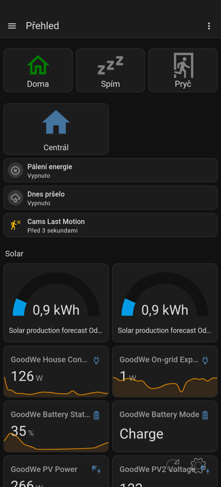
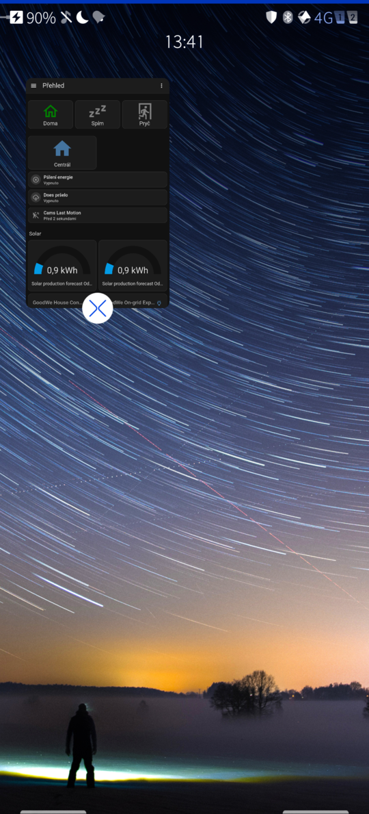

# Homeassistant (harbour-homeassistant)

Fullscreen [Home Assistant](https://www.home-assistant.io/) web interface for
Sailfish OS 5.x (Jolla). A thin wrapper around the Sailfish WebView (Gecko) with
a configurable URL, so the Home Assistant dashboard opens like a native app
instead of a browser tab.

Version: 1.0.0 (see `rpm/harbour-homeassistant.spec`). The UI is in Czech.

## Screenshots

| Dashboard (fullscreen WebView) | App card on the home screen |
|---|---|
|  |  |

---

## 1. Features

- **Fullscreen WebView** of the Home Assistant instance, all orientations.
- **Configurable URL** (settings page, stored in dconf). A scheme-less entry is
  prefixed with `http://`.
- **Logins survive restarts**: localStorage and cookies live in the persistent
  Sailfish WebView profile. Use the "remember me" checkbox on the Home Assistant
  login page (`storeToken`), otherwise Home Assistant itself does not keep the token.
- **No browser password dialog**: the WebView's "save password?" popup
  (`embed:login`) is replaced by an empty item (`NoPasswordPopup.qml`). Home
  Assistant has its own "remember me", and the native dialog used to crash the
  app after answering it.
- **Paused while minimized**: `WebView.hidden` follows `Qt.application.active`,
  so the page stops repainting in the background and Home Assistant can suspend
  its work.
- **Buttons** at the bottom right: reload and settings (semi-transparent). The
  page has no pulley menu because the WebView is not a Flickable.

---

## 2. Settings (dconf)

Path: `/apps/harbour-homeassistant/`

| Key | Default | Meaning |
|---|---|---|
| `url` | `http://homeassistant.local:8123` | Home Assistant base URL |

The stored URL is applied once it is loaded, so the default is never requested
first (`MainPage.loadSavedUrl()`).

---

## 3. Structure

```
harbour-homeassistant.desktop       Sailjail: Internet
rpm/harbour-homeassistant.spec      noarch RPM (Requires: sailfish-components-webview-qt5,
                                    -popups, -pickers, nemo-qml-plugin-configuration-qt5)
icons/<size>/harbour-homeassistant.png
qml/harbour-homeassistant.qml       ApplicationWindow (no cover component)
qml/pages/MainPage.qml              WebView, popup provider, reload/settings buttons
qml/pages/SettingsPage.qml          URL field, Save, Default address
qml/components/NoPasswordPopup.qml  empty stand-in for the password manager popup
docs/                               screenshots for this README
```

---

## 4. Known limitations

- Sailfish OS 5.x does not ship Qt WebEngine (Chromium); the app uses the
  Sailfish WebView (Gecko). Some Home Assistant front-end features may behave
  differently than in Chromium.
- No cover page of its own: the home screen card shows the live WebView
  content scaled down (see screenshot).
- HTTPS with self-signed certificates is handled by the WebView's own dialogs.

---

## 5. Build and deployment

Pure QML, noarch RPM:

```
rpmbuild -bb rpm/harbour-homeassistant.spec \
    --define "_topdir $PWD/build" --define "_sourcedir $PWD/build/SOURCES"
```

with `build/SOURCES/harbour-homeassistant-<version>.tar.gz` containing
`harbour-homeassistant-<version>/{qml,icons,harbour-homeassistant.desktop}`.
On some hosts `--define "__spec_install_post %{nil}"` is needed. Output:
`build/RPMS/noarch/`. The Sailfish SDK (`sfdk build`) works as well.

Install on the phone (developer mode, SSH):

```
scp -P 2233 build/RPMS/noarch/harbour-homeassistant-*.rpm defaultuser@<phone>:/tmp/
ssh -p 2233 defaultuser@<phone> 'devel-su rpm -U --force /tmp/harbour-homeassistant-*.rpm'
```

To restart the app from SSH, kill **only** this process (full command line
`sailfish-qml harbour-homeassistant`). Killing by the process name
`sailfish-qml` terminates every QML app on the phone.

---

## 6. Licence

MIT (see the spec file). Home Assistant is a trademark of the Home Assistant
project; this app only embeds its web interface.
